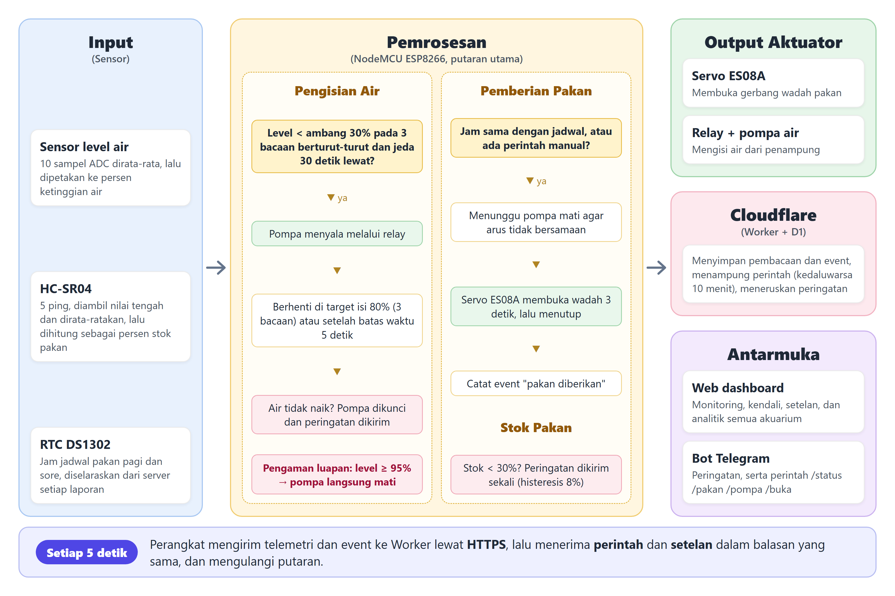

# AQUASMART

Akuarium pintar berbasis IoT, tugas besar mata kuliah Teknologi IoT, Informatika UNS.

NodeMCU ESP8266 memantau ketinggian air (sensor level air) dan stok pakan (HC-SR04), menyalakan pompa
saat air rendah, dan memberi pakan dengan servo menurut jadwal RTC DS1302. Setiap 5 detik alat mengirim
telemetri ke server di Cloudflare Workers dan menerima perintah yang menunggu di balasan yang sama.
Dashboard web menampilkan kondisi tiap akuarium dan dapat mengirim perintah; peringatan juga dikirim
lewat bot Telegram.

Dashboard: https://aquasmart.daffa-hasanal.workers.dev

## Arsitektur

```
ESP8266 --HTTPS POST /api/telemetry--> Cloudflare Worker (Hono) --> D1 (SQLite)
                <--perintah + setelan--          |
Dashboard React <--------- /api/* -------------- +--> Bot Telegram
```

### Alur kerja perangkat



## Struktur folder

| Folder / berkas | Isi |
| --- | --- |
| `firmware/AQUASMART/` | Program ESP8266 (Arduino C++) |
| `src/worker/` | Server: API telemetri, antrean perintah, analitik, jembatan Telegram |
| `src/react-app/` | Dashboard web (React, Tailwind, Recharts) |
| `schema.sql` | Skema basis data D1 untuk database baru |
| `migrations/` | Migrasi database produksi dari satu ke banyak akuarium |
| `simulator/` | Simulator akuarium tambahan untuk uji skalabilitas |
| `test/` | Pengujian otomatis server dan simulator |
| `foto/` | Foto rakitan akhir prototipe |
| `docs/` | Diagram alur kerja perangkat |
| `laporan/referensi/` | Jurnal rujukan laporan |

## Menjalankan

Butuh Node.js 24 atau lebih baru.

```bash
npm install
npx wrangler d1 execute aquasmart --local --file schema.sql   # database lokal
npm run dev                                                    # dashboard + API di http://localhost:5173
npm test
```

Isi `.dev.vars` untuk pengembangan lokal (kunci Telegram boleh dikosongkan):

```
DEVICE_KEY=...
TELEGRAM_BOT_TOKEN=...
TELEGRAM_CHAT_ID=...
TELEGRAM_WEBHOOK_SECRET=...
```

Deploy ke Cloudflare: simpan nilai yang sama dengan `npx wrangler secret put <NAMA>`, jalankan
`schema.sql` dengan `--remote`, lalu `npm run deploy`.

### Firmware

1. Salin `firmware/AQUASMART/secrets.example.h` menjadi `secrets.h` lalu isi WiFi dan `DEVICE_KEY`.
2. Pasang board ESP8266 serta library ArduinoJson, Rtc by Makuna (RtcDS1302), dan Servo.
3. Unggah `AQUASMART.ino` ke NodeMCU.

### Simulator

Salin `simulator/devices.example.json` menjadi `simulator/devices.json`, isi kunci tiap akuarium, lalu
jalankan `npm run simulate`. Tambahkan `SIM_SERVER=http://localhost:5173` untuk menargetkan server lokal.
